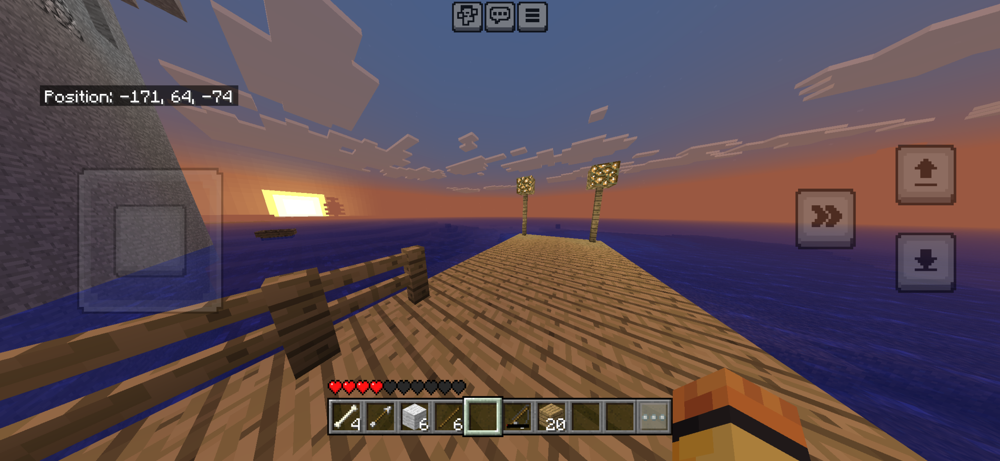
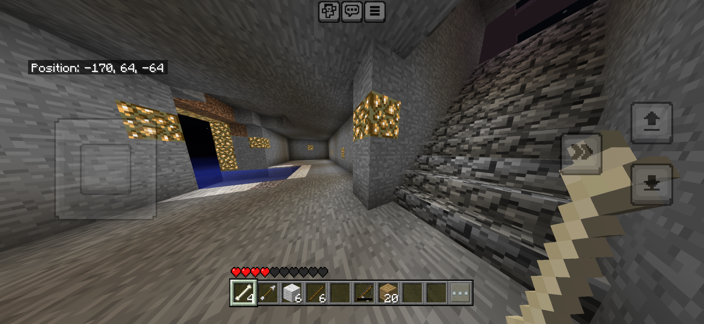
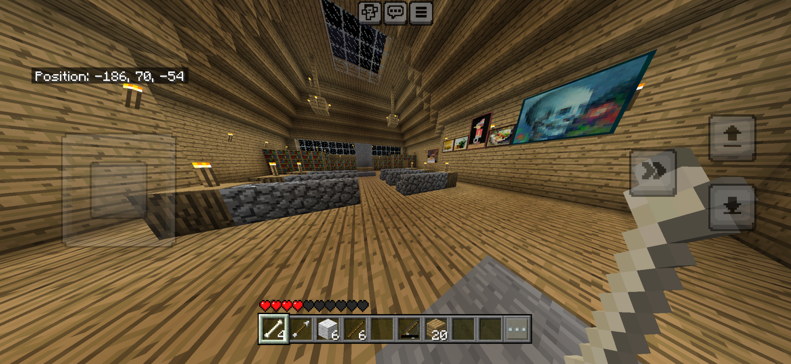
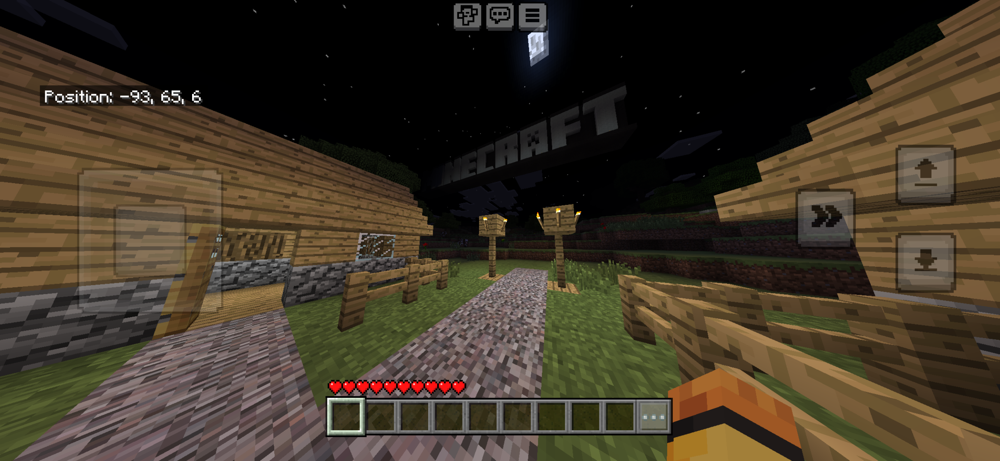
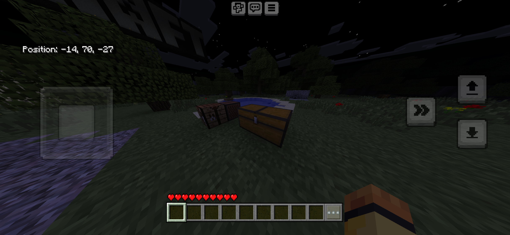
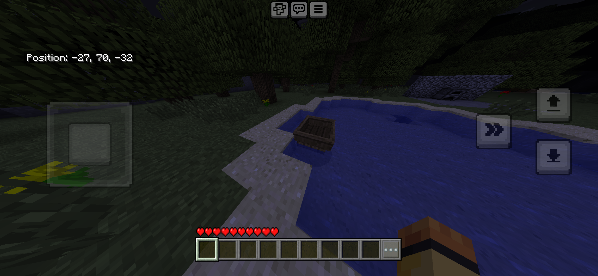

# BetaBridge screenshots

Captured on an unmodified iPhone Bedrock client connected to our Java Beta 1.6.6 test server. The resource pack is offered automatically when joining. This experimental project was built with OpenAI Codex.

## Sunset and classic water

## Classic blocks

## Tutorial interior

## Tutorial at night

## Full-block chests

## Beta boat

The tutorial map is a demonstration world and is not included in the distribution. Screenshots show the tested setup, not a guarantee of compatibility with every Bedrock update.
